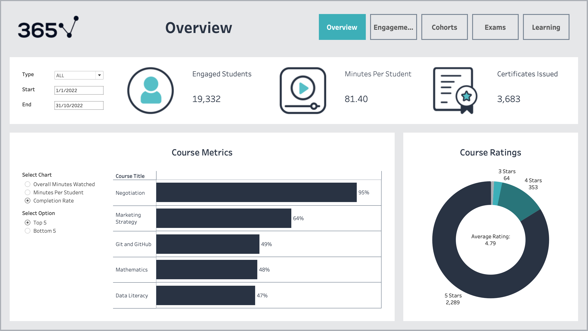
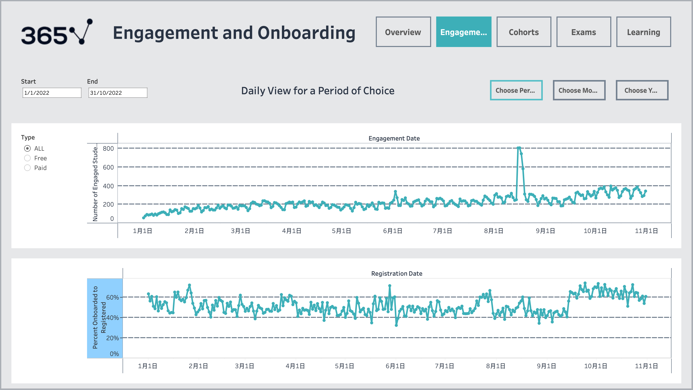
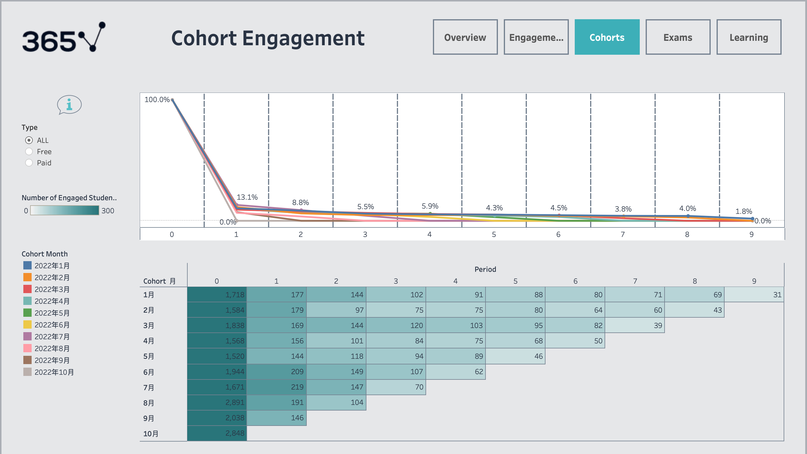
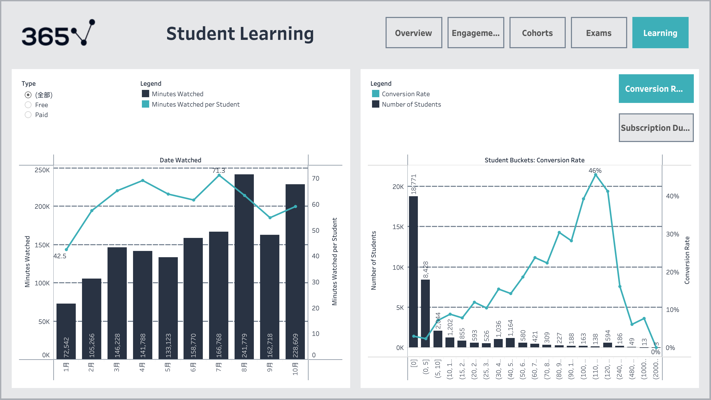
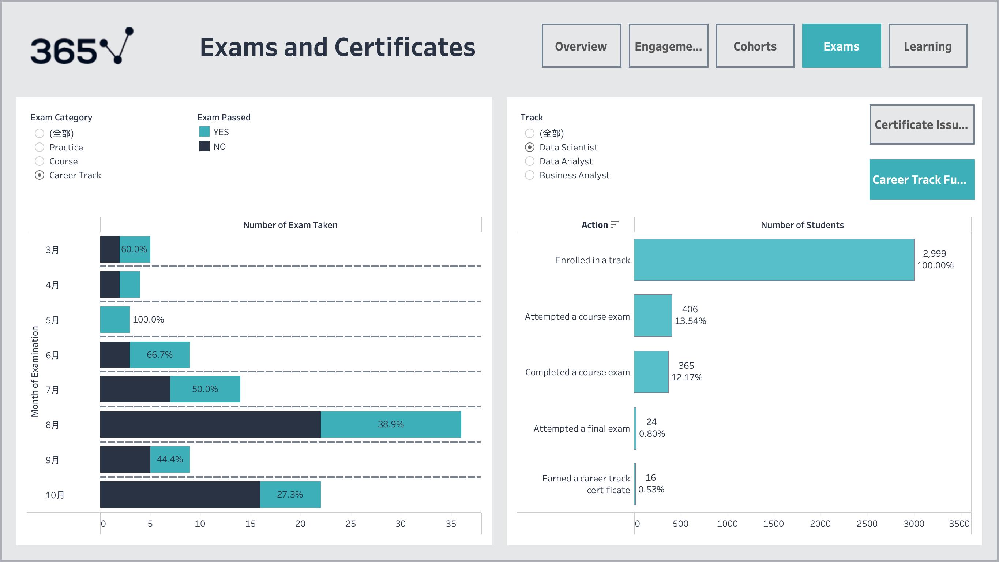

# Online Education Platform — Customer Engagement & Retention Analysis

**MySQL · Tableau · Business Intelligence**

How does an online learning platform turn registrations into engaged learners and paying customers? This project analyzes a 2022 educational platform dataset using SQL and Tableau, focusing on activation, cohort retention, learning behavior and free-to-paid conversion.

## Dashboard Gallery

### Platform Overview



### Engagement & Onboarding



### Cohort Retention



### Learning & Free-to-Paid Conversion



### Exams & Career Tracks



[Explore all dashboard screenshots](dashboard/screenshots/README.md)

## Business Questions

- How many registered learners become active, and which cohorts return?
- How does free-to-paid purchase incidence vary with viewing behavior?
- Which courses attract the most learning activity?
- Where do learners drop off between enrollment, assessment and certification?

## Key Findings

| Finding                                                                                                | Business implication                                                                            |
| ------------------------------------------------------------------------------------------------------ | ----------------------------------------------------------------------------------------------- |
| **19,332 of 37,490 registrations (51.56%)** were ever active                                           | Registration volume alone does not measure engagement                                           |
| January period-1 same-status retention: **2.99% free vs 51.76% paid**                                  | A large descriptive gap, not evidence that payment causes retention                             |
| **2,338 purchasers (6.24%)**; **63 of 138 (45.65%)** in the (110, 120] viewing-minute bucket purchased | Viewing intensity can inform segmentation, but does not establish a causal conversion threshold |
| Five foundational courses account for **55.14%** of raw viewing minutes                                | High-traffic learning paths are candidates for targeted improvements                            |
| **43 career-track certificates** issued to **39 people**, alongside **7,874 track enrollments**        | Examine assessment progression; these counts are not a validated chronological funnel           |

## Recommendations

1. Experiment with first-week learning guidance to improve return engagement.
2. Evaluate upgrade prompts with comparable pre-intervention exposure windows and purchase follow-up.
3. Investigate progression from course activity to first assessment before redesigning the certification journey.

## Methodology

The case-study snapshot covers **37,490 registrations (January–October 2022)** and **11 relational tables**. The workflow is **SQL data preparation → metric definitions and quality checks → aggregate results → Tableau visualization → business interpretation**.

For methodology and interpretation, see [analysis report](docs/analysis_report.md), [metric definitions](docs/metric_definitions.md), and [data guide](data/README.md).

## Repository Structure

```text
sql/                 Curated SQL queries and data quality checks
data/results/        Aggregate analysis outputs
dashboard/screenshots/ Dashboard gallery
docs/                Analysis report, metric definitions and validation evidence
scripts/             SQL execution and export utilities
```

## Reproducibility & Data Access

This repository includes SQL queries, aggregate results, dashboard screenshots and supporting documentation. The underlying dataset and Tableau workbooks are not redistributed. Run the SQL workflow with an authorized copy of the source data.

## Scope

Findings describe observed patterns, not causal effects. See the [analysis report](docs/analysis_report.md) for metric definitions and analytical constraints.
