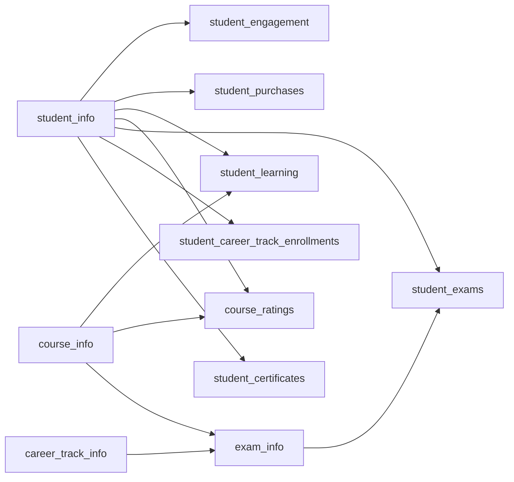

# Data, Provenance & Reproduction

## Five distinct layers

1. **Original database:** `review_materials/raw/customer_engagement.sql`, an unchanged MySQL 8.0 dump.
2. **Curated queries:** `sql/`, the reproducible business logic.
3. **SQL outputs:** aggregate `.tsv` files in `data/results/`; original historical CSVs in `review_materials/exports/` are reconciliation references.
4. **Tableau sources:** ten embedded Hyper extracts in each TWBX. Original and reviewed workbooks are versioned separately. Two corrected refresh CSVs are provided under `review_materials/tableau_refresh/`.
5. **Interpretation:** `docs/analysis_report.md`, with definitions and links to evidence.

The handoff identifies this as a 365 learning platform educational case study. Extraction completeness, sampling methodology and redistribution license are not supplied. Source data, source references and packed workbooks are provided for **local independent review**, excluded from future commits by `.gitignore`. The TWBX files themselves contain row-level data, even if the external CSV folder is excluded. No permission to redistribute them is inferred.

## Source schema

| Table | Rows | Grain / link |
|---|---:|---|
| student_info | 37,490 | One student; `student_id` links activity, purchase, learning and outcomes |
| student_engagement | 68,340 | Activity event ID, student, date, three action flags |
| student_learning | 85,945 | Student/course/date learning row and minutes; multiple rows must be summed |
| student_purchases | 3,330 | Purchase ID, student, plan type, purchase/refund dates |
| course_info | 56 | Course ID, title, duration |
| course_ratings | 2,731 | Student/course rating |
| exam_info | 907 | Exam ID, category, course or track association |
| student_exams | 35,359 | Attempt ID, student/exam, binary pass, completion date |
| student_certificates | 3,683 | Certificate ID, student, type, course or track, issuance date |
| career_track_info | 24 | Track/course membership |
| student_career_track_enrollments | 7,874 | Student/track/date enrollment |



Arrows indicate analytical joins, not guaranteed declared foreign-key constraints. The course/track alternatives in exam and certificate tables explain structural nulls. Validation checks orphan student references in the core tables.

## Reproduce with MySQL + Tableau

1. Use a fresh disposable MySQL instance. The original dump creates `customer_engagement` and contains DROP TABLE statements; do not import it over an existing database.
2. Import the authorized source dump with MySQL 8.x / Workbench. Example: `mysql -u your_user -p < review_materials/raw/customer_engagement.sql`.
3. Run `bash scripts/run_sql.sh -u your_user -p`, then `bash scripts/export_results.sh -u your_user -p` from the project root.
4. Inspect `docs/qa/execution_logs/` and `data/results/`. Open the preserved or reviewed TWBX in Tableau. Embedded extracts make an external database connection unnecessary for viewing.
5. To refresh from SQL, export the documented view outputs as UTF-8 CSV with headers, point each Tableau source to its matching CSV, and ensure F2P minutes are **Number (decimal)**. The reviewed workbook already contains corrected extracts; do not refresh it from the old learning CSV.

**Actual test environment:** an isolated MySQL **5.7.24** instance with TCP networking disabled. The 8.0 dump's `utf8mb4_0900_ai_ci` collation is unsupported by 5.7, so a disposable import copy replaced only that collation name with `utf8mb4_unicode_ci`. Source rows and the delivered dump were unchanged. Queries ran under `ONLY_FULL_GROUP_BY` and strict SQL mode. The locally installed MySQL 9.1 initializer crashed; no 8.x/9.x runtime pass is claimed. Numeric-ID joins and historical outputs were reconciled against the supplied exports.

## Optional independent QA and repair

These helpers are tooling only; business calculations stay in MySQL.

```bash
python3 scripts/verify_exports.py -u your_user -p
# Optional isolated environment for Hyper-level audits / regenerating the reviewed TWBX:
python3 -m venv .qa-venv
source .qa-venv/bin/activate
python -m pip install tableauhyperapi==0.0.26479
python scripts/audit_tableau.py -u your_user -p
# Only needed if regenerating the reviewed derivative after SQL changes:
python scripts/repair_tableau.py -u your_user -p
```

Python 3.9+ is needed only for these optional helpers. The Hyper API was used locally with telemetry disabled. It checks all embedded rows, not only table counts. `verify_exports.py` expects the known 12,181-row historical learning defect; it does not disguise it as a clean match. `audit_tableau.py` expects the two documented original workbook defects and zero discrepancies in the reviewed version. Numeric comparison tolerance is 0.011 for two-decimal exports.

## Public-release boundary

The ZIP is a complete local review handoff, **not a license grant**. Public code/report preparation is complete; publication of raw records and packed extracts remains contingent on permission. A public clone that excludes these files can show the documented aggregate findings, but full reproduction requires authorized access to the original dump and CSVs. Confirm permission for original preview imagery before publishing it as well. The public repository excludes source records, reference materials and packaged workbooks; no Tableau Public upload is part of this release.
